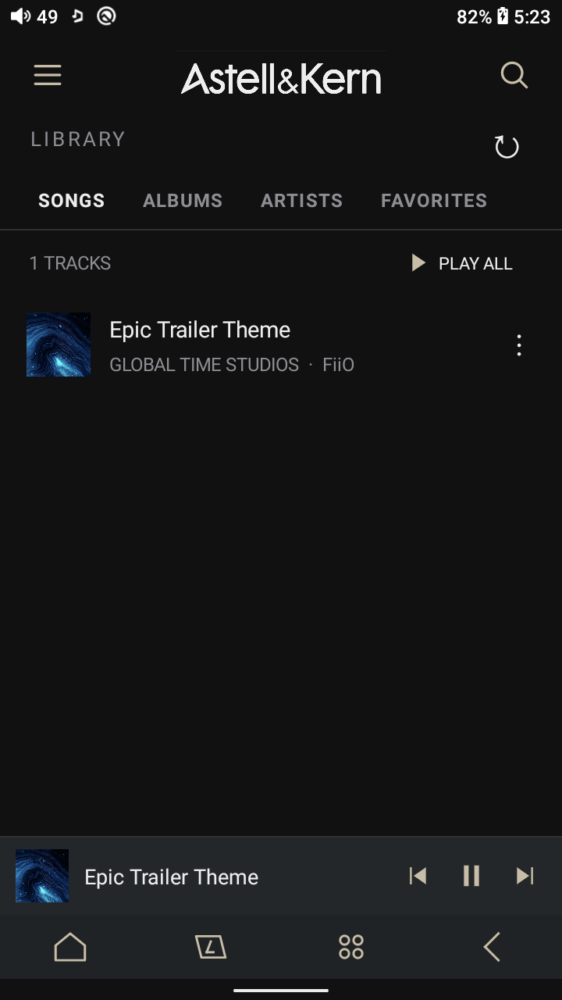
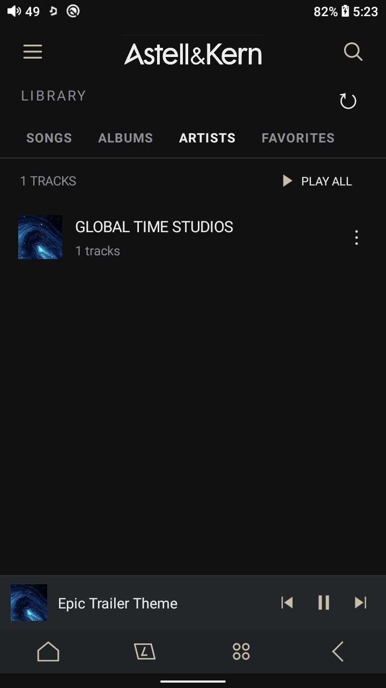
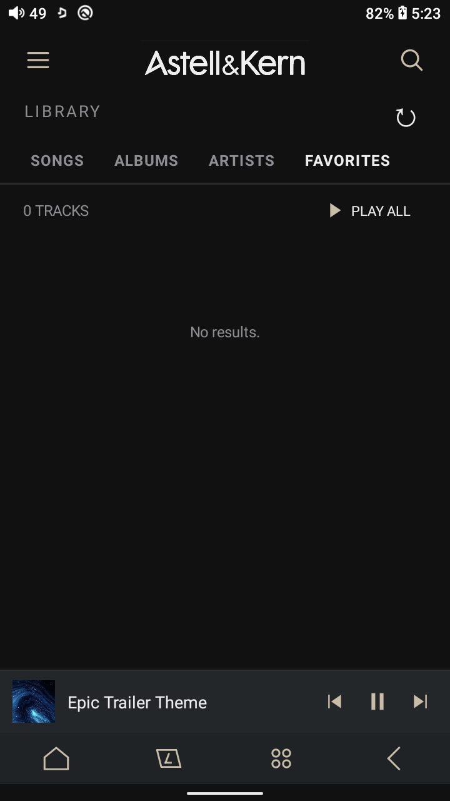
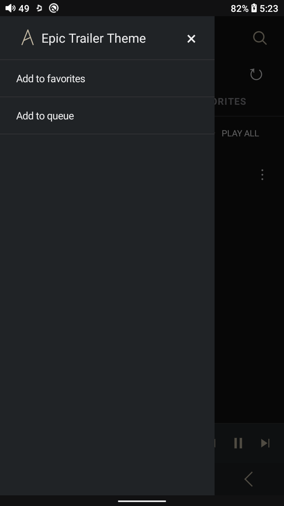
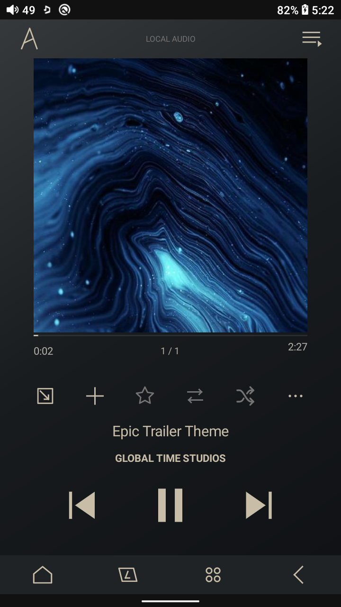
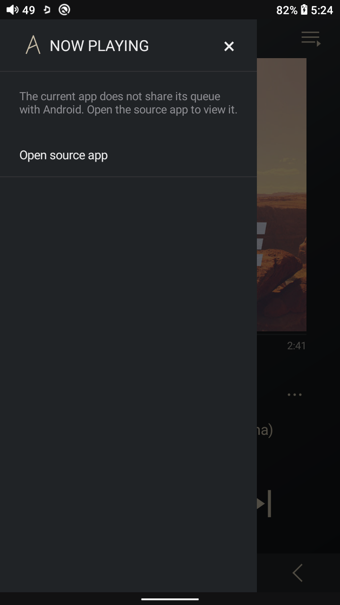
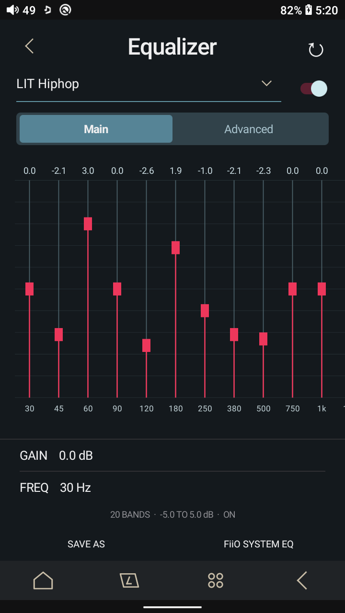
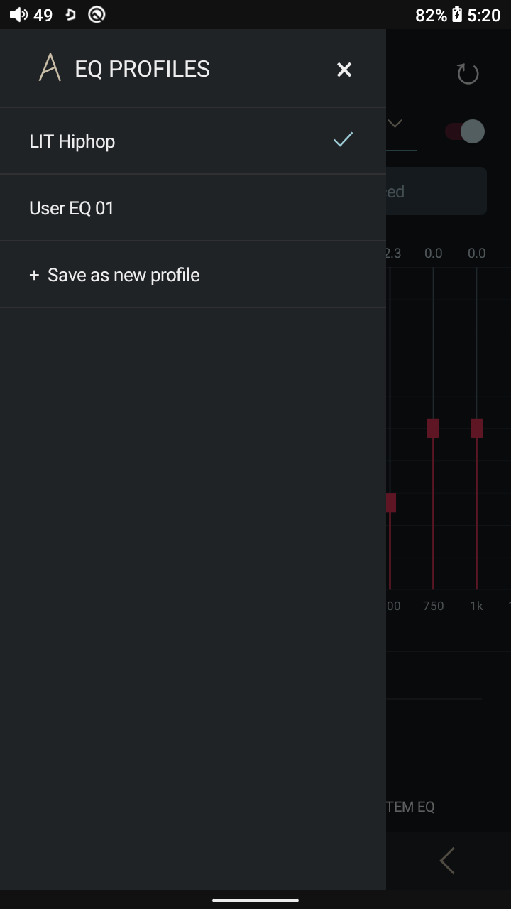
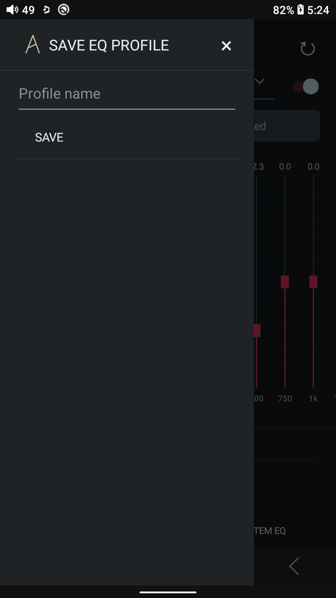

# Crimson Player

Crimson Player is an Android music player inspired by the Astell&Kern SR35 interface. It brings a dedicated-player layout to local music, with an equalizer, a compact player, and controls for compatible music apps.

This is an independent project and is not affiliated with Astell&Kern or FiiO.

## Features

- **Music library:** browse local songs, albums, artists, and favorites; search by title, artist, or album.
- **Playback:** view album artwork, seek, skip tracks, shuffle, repeat, and manage the current queue. A compact player remains available below the library.
- **Equalizer:** adjust up to 20 frequency regions on devices supporting Android DynamicsProcessing. Save named EQ profiles and switch between them; devices without that effect fall back to Android's native equalizer.
- **Other music apps:** view and control compatible active media sessions after granting notification access. Queue contents and supported controls depend on the source app.
- **AMP shortcuts:** open FiiO audio settings to adjust the hardware gain on compatible devices.

The in-app EQ affects audio played by Crimson Player. It does not process audio from Spotify, Tidal, or other apps. Its fixed frequency regions and available controls do not reproduce the SR35's parametric EQ or Q settings. AMP gain is adjusted in FiiO settings rather than directly inside this app.

## Screenshots

The following screenshots were captured on a FiiO M11S. Track information, artwork, and EQ profiles reflect the device state at the time of capture.

### Library and navigation

<table>
  <tr>
    <td align="center" valign="top" width="25%"><br>Songs and mini player</td>
    <td align="center" valign="top" width="25%"><br>Albums</td>
    <td align="center" valign="top" width="25%"><br>Artists</td>
    <td align="center" valign="top" width="25%"><br>Favorites</td>
  </tr>
</table>

<table>
  <tr>
    <td align="center" valign="top" width="25%"><br>Navigation</td>
    <td align="center" valign="top" width="25%"><br>Search</td>
    <td align="center" valign="top" width="25%"><br>Track options</td>
    <td align="center" valign="top" width="25%"><br>Album details</td>
  </tr>
</table>

### Playback

<table>
  <tr>
    <td align="center" valign="top" width="25%"><br>Now playing</td>
    <td align="center" valign="top" width="25%"><br>Playback queue</td>
    <td align="center" valign="top" width="25%"><br>Other app playback</td>
    <td align="center" valign="top" width="25%"><br>Other app queue</td>
  </tr>
</table>

### Audio settings

<table>
  <tr>
    <td align="center" valign="top" width="25%"><br>Equalizer</td>
    <td align="center" valign="top" width="25%"><br>EQ profiles</td>
    <td align="center" valign="top" width="25%"><br>Save a profile</td>
    <td align="center" valign="top" width="25%"><br>AMP settings</td>
  </tr>
</table>

## Get started

Open the project in Android Studio with Android SDK 36 installed, or build the debug APK with:

```sh
./gradlew assembleDebug
```

The APK is created at `app/build/outputs/apk/debug/app-debug.apk`. Grant audio access to load local music. To control another music app, open **Playing from other apps** and enable notification access when prompted.

The app requires Android 6.0 or later. Audio formats and effect availability depend on the device. Playback currently runs in the app process and does not provide a media notification or foreground service.
