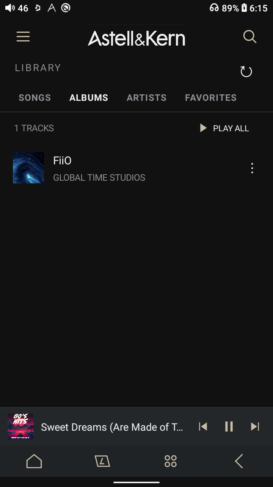
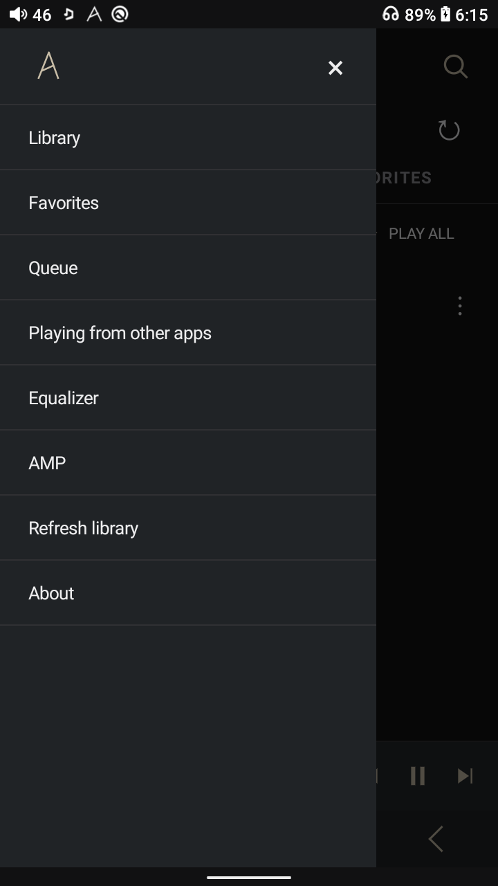
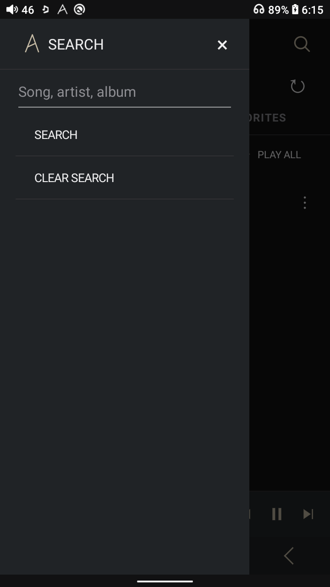
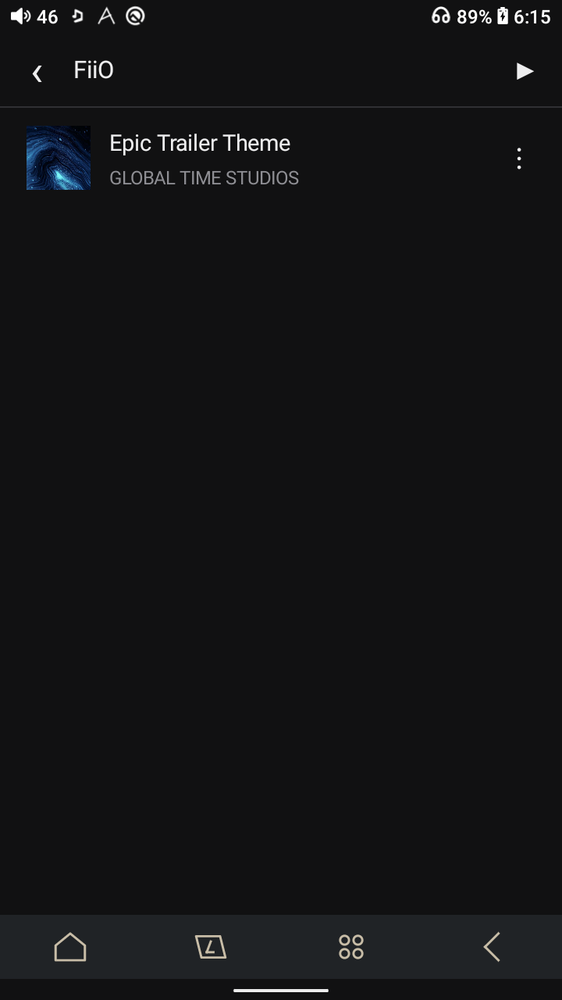
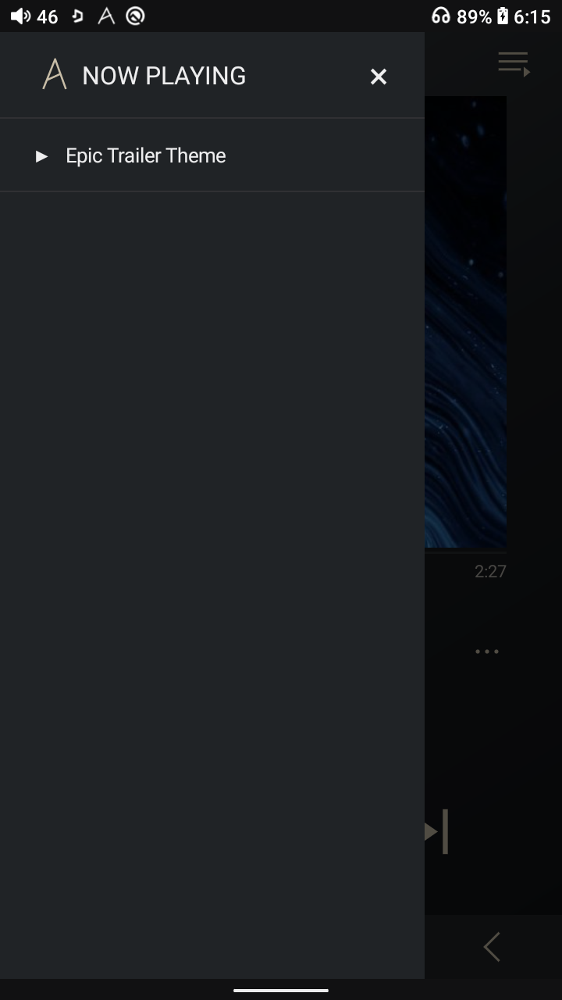
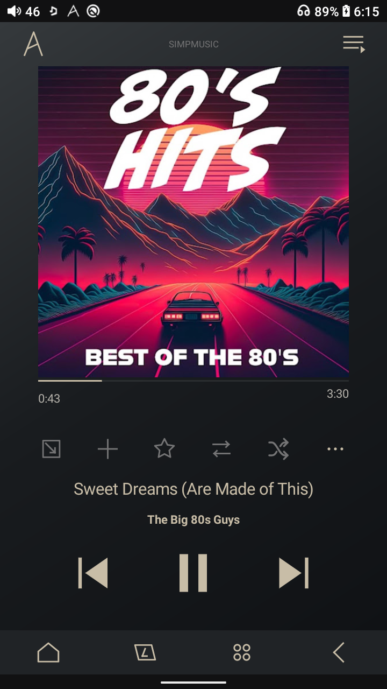
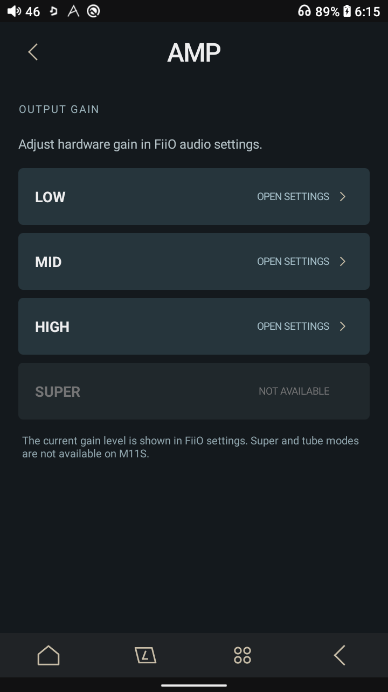

# Crimson Player

Crimson Player is an Android music player inspired by the Astell&Kern SR35 interface. It brings a dedicated-player layout to local music, with an equalizer, a compact player, and controls for compatible music apps.

This is an independent project and is not affiliated with Astell&Kern or FiiO.

[Download Crimson Player 1.1.0 APK](https://github.com/luongwnv/astell-kern-application/releases/download/v1.1.0/crimson-player-1.1.0-debug-signed.apk) · [Release notes](docs/releases/v1.1.0.md)

## Features

- **Music library:** browse local songs, albums, artists, and favorites; search by title, artist, or album.
- **Playback:** view album artwork, seek with a 48dp touch target that keeps the scrubbed position while the source catches up, skip tracks, shuffle, repeat, and manage the current queue. A compact player remains available below the library.
- **System equalizer:** choose from 20 genre profiles (Hip-hop, Rap, Ballad, Pop, Rock, Jazz, Classical, Acoustic, EDM, R&B, Metal, Country, Blues, Reggae, Latin, K-pop, V-pop, Lo-fi, Soul, Instrumental) and adjust up to 20 frequency regions on devices supporting Android DynamicsProcessing on the output mix. Changes are heard immediately; **Save** updates the selected profile, **Revert** restores its last saved values, and **Save As** creates a new profile. Unsaved drafts are retained separately for each profile, including across app restarts. Genre curves are starting points for personal tuning; Save can overwrite a genre profile, and Revert restores its last save. Built-in defaults never overwrite your saved settings. Native fallback EQ bands use frequency interpolation. Devices without DynamicsProcessing try Android's native equalizer on the same output mix.
- **Other music apps:** view and control compatible active media sessions after granting notification access. Queue contents and supported controls depend on the source app.
- **AMP shortcuts:** open FiiO audio settings to adjust the hardware gain on compatible devices.

The EQ attaches to Android's global output mix (audio session 0), so compatible mixed audio from Crimson Player and other apps uses the same settings. A foreground service and persistent notification keep enabled EQ alive when leaving or closing the activity. Turn it off using the switch in Equalizer. Force-stopping the app stops EQ; reopen the app to restore it. There is no automatic startup after reboot.

System-wide EQ support depends on firmware: Android [deprecates insert effects on session 0](https://developer.android.com/reference/android/media/audiofx/AudioEffect), and direct, offloaded, bit-perfect, DSD, or exclusive USB output can bypass the mix. The app reports unavailable system EQ instead of silently applying only to local playback. If necessary, use **Open FiiO System EQ** on that screen. Its fixed frequency regions and available controls do not reproduce the SR35's parametric EQ or Q settings. AMP gain is adjusted in FiiO settings rather than directly inside this app.

Opening the library reuses the running EQ and creates local playback only when a track is selected. Library scanning runs on a background worker. When EQ is off, opening the library does not attach an output-mix effect.

## Screenshots

The following screenshots show version 1.1.0 on a FiiO M11S. Track information, artwork, and EQ profiles reflect the device state at the time of capture.

### Library and navigation

<table>
  <tr>
    <td align="center" valign="top" width="25%"><br>Songs and mini player</td>
    <td align="center" valign="top" width="25%"><br>Albums</td>
    <td align="center" valign="top" width="25%"><br>Artists</td>
    <td align="center" valign="top" width="25%"><br>Favorites</td>
  </tr>
</table>

<table>
  <tr>
    <td align="center" valign="top" width="25%"><br>Navigation</td>
    <td align="center" valign="top" width="25%"><br>Search</td>
    <td align="center" valign="top" width="25%"><br>Track options</td>
    <td align="center" valign="top" width="25%"><br>Album details</td>
  </tr>
</table>

### Playback

<table>
  <tr>
    <td align="center" valign="top" width="25%"><br>Now playing</td>
    <td align="center" valign="top" width="25%"><br>Playback queue</td>
    <td align="center" valign="top" width="25%"><br>Other app playback</td>
    <td align="center" valign="top" width="25%"><br>Other app queue</td>
  </tr>
</table>

### Audio settings

<table>
  <tr>
    <td align="center" valign="top" width="25%"><br>Equalizer</td>
    <td align="center" valign="top" width="25%"><br>EQ profiles</td>
    <td align="center" valign="top" width="25%"><br>Save a profile</td>
    <td align="center" valign="top" width="25%"><br>AMP settings</td>
  </tr>
</table>

## Get started

Open the project in Android Studio with Android SDK 36 installed, or build the debug APK with:

```sh
./gradlew assembleDebug
```

The APK is created at `app/build/outputs/apk/debug/app-debug.apk`. Grant audio access to load local music. To control another music app, open **Playing from other apps** and enable notification access when prompted.

The app requires Android 6.0 or later. Audio formats and effect availability depend on the device. Local playback currently runs in the activity and does not provide a playback notification or playback foreground service. The system EQ has its own foreground service while enabled. The service declares the [special-use type](https://developer.android.com/develop/background-work/services/fgs/service-types#special-use) for continuous user-enabled output processing.

## Hardware EQ verification

The integration test requires a device that supports output-mix EQ. It checks Save/Revert, separate per-profile drafts, background lifetime, and service restoration. Run it without Gradle's connected-test uninstall step on a personal device:

```sh
./gradlew assembleDebug assembleDebugAndroidTest lintDebug
adb install -r app/build/outputs/apk/debug/app-debug.apk
adb install -r app/build/outputs/apk/androidTest/debug/app-debug-androidTest.apk
adb shell am instrument -w com.example.akplayer.test/androidx.test.runner.AndroidJUnitRunner
```

The test restores the preferences it snapshots before running. Gradle's `connectedDebugAndroidTest` uninstalls the app after testing and can delete existing app data; use a disposable test device for that command.
